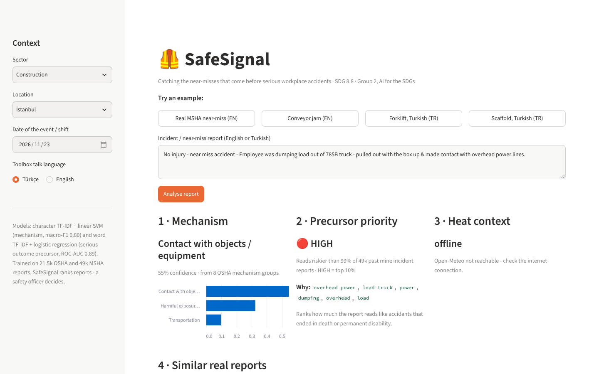
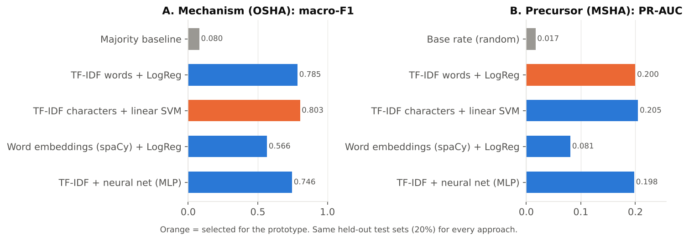

# SafeSignal – catching the near-misses that precede serious workplace accidents

**AI for the SDGs Capstone – Group 2** · Mehmet Emre Uğurlu, Mert Topçakar, Emre Aküzüm, Erdal Emre Ayaydın
**SDG 8 – Target 8.8** (safe and secure working environments), Indicator 8.8.1 · secondary link: SDG 13 (climate / heat)

> **The question we answer:** *Which small incidents are warning signs of a big accident?*
> SafeSignal reads free-text incident and near-miss reports, flags the ones that "read like" a fatal or disabling
> accident, adds weather context, and turns real accident reports into a **sector-specific 5-minute toolbox talk**
> (iş başı eğitimi) for the next shift.

## ▶ Assignment 2 – working prototype



**Run it** (Python 3.10+):
```bash
pip install -r requirements.txt
streamlit run app.py          # opens http://localhost:8501 – first start trains the models (~30 s)
```
Paste an incident or near-miss report (English or Turkish), choose sector, city and date, press **Analyse report**:

| Step | What the tool does | Model / source |
|---|---|---|
| 1 Mechanism | Classifies what happened into 8 OSHA mechanism groups (falls, caught-in/struck-by, transport, heat/electricity/chemicals …) | TF-IDF character 3–5-grams + linear SVM (calibrated) |
| 2 Precursor priority | Scores how much the report *reads like* accidents that ended in death or permanent disability; ranks it against 52k past mine reports (HIGH = top 10 %) and shows the evidence words | TF-IDF words + logistic regression, outcome words removed |
| 3 Heat context | Live daily max temperature for the place and date; shows the injury-rate ratio we measured for that temperature band | Open-Meteo API + our OSHA × Open-Meteo analysis |
| 4 Similar real reports | Retrieves the 3 most similar real OSHA / MSHA reports and how they ended | TF-IDF cosine similarity over ~75k reports |
| 5 Toolbox talk | Writes a 5-minute pre-shift briefing (Turkish / English) that starts with this report's hazard, adds a heat block on hot days, downloadable as .md | Retrieval + templates (`src/05_toolbox_talk.py`) |

Command-line version: `python src/safesignal_core.py "your report text"`. Demo recording script: `docs/demo_video_script.md`.

### Models we tried and which one won
Same held-out test sets (stratified 20 %, seed 42) for every approach – `src/08_model_comparison.py`, results in `results/model_comparison_*.csv`.



**A. Mechanism (OSHA, 4,315 test reports, 8 classes)**

| Approach | Accuracy | Macro-F1 | Train time |
|---|---|---|---|
| Majority baseline | 0.469 | 0.080 | – |
| TF-IDF words + logistic regression (A1 baseline) | 0.896 | 0.785 | 1.2 s |
| **TF-IDF characters + linear SVM ✔ selected** | **0.907** | **0.803** | 1.6 s |
| Pre-trained word embeddings (spaCy en_core_web_md, averaged) + LogReg | 0.727 | 0.566 | 1.9 s |
| TF-IDF + neural network (MLP, 128 hidden units) | 0.903 | 0.746 | 51 s |

**B. Serious-outcome precursor (MSHA, 10,345 test reports, 1.7 % serious)**

| Approach | ROC-AUC | PR-AUC | Recall @ top 10 % | Train time |
|---|---|---|---|---|
| Base rate (random) | 0.500 | 0.017 | 0.080 | – |
| **TF-IDF words + logistic regression ✔ selected** | **0.890** | 0.200 | **0.646** | 0.2 s |
| TF-IDF characters + linear SVM | 0.887 | **0.205** | 0.629 | 5.2 s |
| Pre-trained word embeddings (spaCy) + LogReg | 0.793 | 0.081 | 0.451 | 0.8 s |
| TF-IDF + neural network (MLP) | 0.883 | 0.198 | 0.611 | 113 s |

*Recall @ top 10 %: if a safety officer reviews only the 10 % highest-ranked reports, 65 % of the reports that really ended in
death or permanent disability are among them (8 % with random order).*

**Why these won**
* **Mechanism → character n-grams.** Safety reports are full of spelling variants, compound words and abbreviations
  (*fork lift / forklift*, *amputated / amputation*, *EE*). Character n-grams share evidence across these forms, which gave the
  best macro-F1, mostly on the small classes. The MLP was 30× slower without gaining accuracy on the rare classes.
* **Precursor → word TF-IDF + logistic regression.** The top three approaches are within 0.007 PR-AUC – a statistical tie.
  Logistic regression has the best ROC-AUC and recall @ top 10 %, trains in 0.2 s and, most importantly, its word weights give
  the **"Why"** evidence shown in the app, which a safety officer can check.
* **Pre-trained embeddings lost on both tasks.** Averaging general-purpose word vectors blurs the few decisive words
  (*ladder* vs *scaffold*, *energised* vs *locked out*); without fine-tuning on safety text they underperform simple TF-IDF.
  (Transformer models from Hugging Face could not be downloaded in our environment; they are on our list for Assignment 3.)
* **Leakage check that changed our result.** The first character-n-gram run scored PR-AUC 0.495 – too good to be true.
  The character analyser was seeing outcome words (*amput…*, *fatal…*) that the word model's stop-list removed. We now strip
  outcome words and stems from the text itself before **every** model (`clean_text` in `src/safesignal_core.py`); after the
  fix all models fall to ~0.20, the honest value.

### Turkish input (experimental)
Our users are in Türkiye but the training data is English. `tr_to_en()` maps ~150 Turkish safety terms and phrases
(*iskele, forklift, geri manevra, sıkıştı, havai hat, elinden düştü …*) to English before scoring, and the app shows the
translated words so the user can see what the model read. In our examples the forklift near-miss is correctly classified as
*Transportation*; complex sentences can lose meaning (e.g. a dropped hammer is read as a fall). Systematic tests with Turkish
reports are planned for Assignment 3.

### Changes based on Assignment 1 feedback
See the table below – narrower idea (near-miss precursors), OSHA reports, SGK / İSİG / HSE context, Open-Meteo heat analysis
(construction + agriculture injury rate ×1.48 on 30–35 °C days) and the toolbox-talk tool. In Assignment 2 all of these are now
**connected in one working application** instead of separate scripts.

## Assignment 1 (revised) – what changed after feedback
| Feedback | What we did |
|---|---|
| The idea is too general – sharpen it | Narrowed the focus to **near-miss → serious-accident precursors** and a concrete output (toolbox talk) |
| Use OSHA Severe Injury Reports | Added **21,578 OSHA narratives** (2015-01 → 2017-02) with sector, date, location and injury codes |
| Türkiye: SGK, İSİG; UK: HSE for comparison | Added SGK 2024–25, İSİG Meclisi 2025 (sector + cause), HSE 2025/26 and BLS 2024 figures with sources |
| Add weather from Open-Meteo, test extreme heat in construction/agriculture | Built `04_weather_openmeteo.py`: joins every report to the day's max temperature (ERA5) and compares injury **rates** by temperature band |
| Focus on near-misses for originality | Added **MSHA mine reports (60,000)** that include **5,231 no-injury events**, trained a "serious-outcome" text model and scored every near-miss |
| Output: a tool that writes a sector-specific toolbox talk from real reports | Built `05_toolbox_talk.py` (Turkish / English, retrieval + templates, optional LLM rewrite) |

## Data
| File | Source | Rows | Used for |
|---|---|---|---|
| `data/ihm_stefanini_accidents.csv` | IHM Stefanini, Industrial Safety & Health Analytics DB (Kaggle) | 425 | Actual vs **potential** severity – the near-miss signal |
| `data/osha_severe_injury_2015_2017.csv.gz` | U.S. OSHA Severe Injury Reports (employer names/addresses removed) | 21,578 | Sector × mechanism EDA, heat analysis, mechanism classifier, toolbox talks |
| `data/msha_accidents_2016_2026.csv.gz` | U.S. MSHA mine accident reports (Form 7000-1), most recent 60,000 records | 60,000 | Severity pyramid and near-miss precursor model |
| `data/turkey_international_context.csv` | SGK, İSİG Meclisi, HSE (GB), BLS (US) – URLs in the file | 25 | Türkiye relevance and comparison |
| `data/weather_cache.csv` | Open-Meteo historical weather API (ERA5), downloaded 2026-10-31 | ~136k | Daily max temperature per location-day |

## Pipeline
| Script | What it does | Key result |
|---|---|---|
| `src/01_ihm_near_miss.py` | EDA + triage baseline on IHM | 28% of "Level I" events had Level IV+ potential; TF-IDF + LogReg macro-F1 0.68 (baseline 0.37) |
| `src/02_osha_eda.py` | Sector × mechanism profile, heat seasonality, mechanism classifier | Mechanism from text: **accuracy 0.90, macro-F1 0.79** (4,315 test reports); 82% of heat injuries in Jun–Aug |
| `src/03_msha_precursors.py` | Severity pyramid per mechanism; serious-outcome model (outcome words removed); scores all near-misses | **ROC-AUC 0.89, PR-AUC 0.21 vs 0.017 random**; 497 of 5,231 near-misses (9.5%) flagged as "reads like a serious accident" |
| `src/04_weather_openmeteo.py` | OSHA × Open-Meteo daily max temperature; injury rate per 1,000 location-days by temperature band | 172 grid cells, 135,880 location-days: construction + agriculture injury rate **+48% on 30–35 °C days** vs 20–25 °C (other sectors +23%); correlation, not yet controlled for seasonal workforce |
| `src/05_toolbox_talk.py` | Sector-specific 5-minute toolbox talk from real reports | Examples in `outputs/toolbox_talks/` |
| `src/06_turkey_context.py` | Türkiye / GB / US context figure | İSİG 2025: ≥2,105 worker deaths; SGK 2025: 1,931 |
| `src/07_ihm_triage_demo.py` | Scores a new free-text report | "the chain broke and the load fell…" → P(high) = 0.73 |
| `src/08_model_comparison.py` | **A2:** five approaches × two tasks on identical test sets | see the tables above |
| `src/safesignal_core.py` + `app.py` | **A2:** shared pipeline and Streamlit prototype | end-to-end tool |

## How to run
```bash
pip install -r requirements.txt
python run_all.py                       # everything, incl. Open-Meteo download
python src/05_toolbox_talk.py --sector Construction --lang tr --month 7
python src/05_toolbox_talk.py --list    # available sectors
```

## Why these modelling choices
* **Text → mechanism** and **text → serious-outcome** are both TF-IDF + logistic regression: fast, measurable and
  explainable (each flag comes with the words behind it). Transformer embeddings and an LLM classifier are the
  Assignment 2 comparison.
* **Label leakage control:** words that describe the *outcome* (died, amputated, hospital, surgery …) are removed
  before training the serious-outcome model, so it learns the *mechanism* – which is all a near-miss report contains.
* **Near-misses are held out** from training and only scored, so the model never sees the reports it ranks.
* **Weather uses rates, not counts:** injuries per 1,000 location-days in each temperature band, so hot bands are
  not favoured just because there are more summer working days.

## Ethics (summary)
False negatives (a dangerous near-miss marked low) are the main risk → the tool ranks, a safety officer decides.
The data are U.S. / one Latin-American company, so results must be re-validated on Turkish reports before use.
No personal data is used as a feature (OSHA employer names and addresses were removed). The optional LLM step may
only rephrase retrieved facts; it never adds numbers or medical advice.

## Sources
ILO (2023) *A Call for Safer and Healthier Working Environments* · UN SDG metadata 8.8.1 · OSHA Severe Injury
Reports · MSHA Accident Injuries data · IHM Stefanini (Kaggle) · SGK statistics as reported in Evrensel (2026) ·
İSİG Meclisi 2025 report as reported in Bianet · HSE fatal injury statistics 2025/26 · BLS CFOI 2024 · Open-Meteo
Historical Weather API (ERA5).
